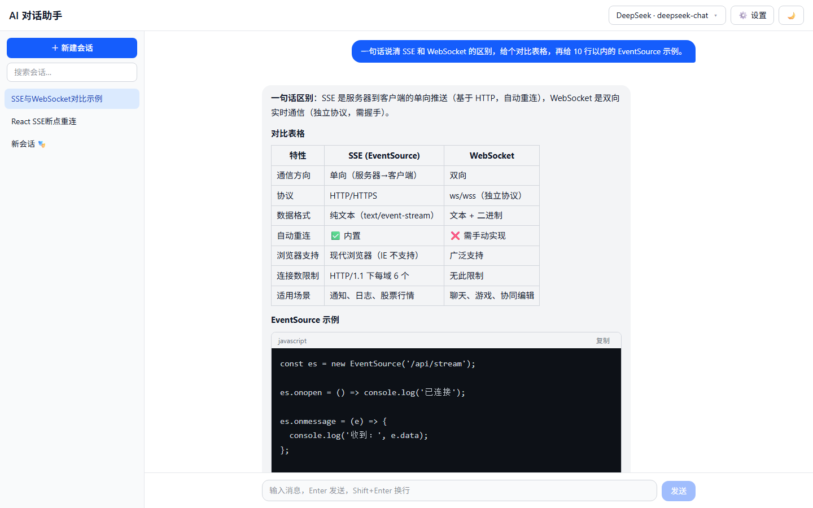
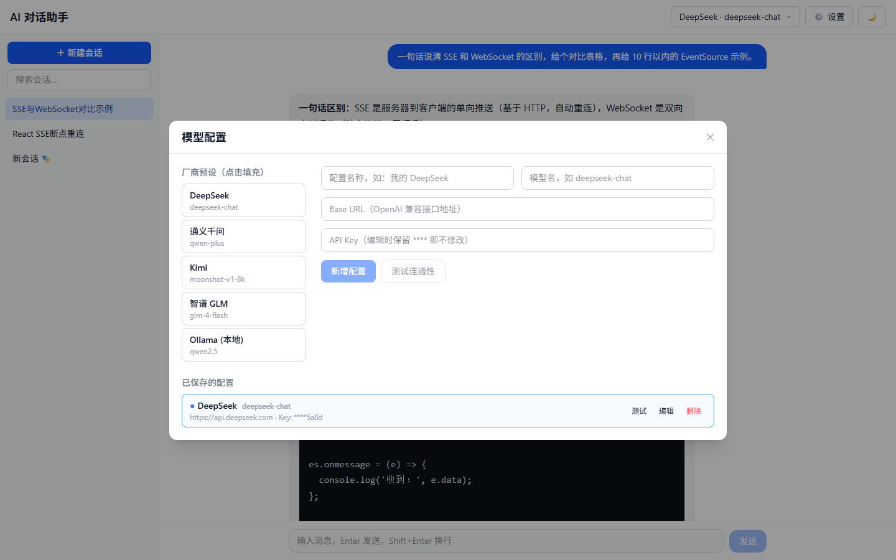

# AI 对话助手

前后端分离的 AI 对话应用：SSE 流式输出、断线自动续答、多厂商模型一键切换。

[](https://github.com/goodnight-elis/ai-chat-assistant/actions/workflows/ci.yml)
[](LICENSE)
[](https://react.dev)
[](https://fastapi.tiangolo.com)



## 为什么写这个

市面上的 AI 客户端大多绑定单一厂商，换模型要换 App；自己搭一套又要重复处理流式渲染、断线、上下文超限这些和业务无关的脏活。

这个项目想做的是**一个不绑定厂商的对话前端**：后端只依赖 OpenAI 兼容协议，厂商差异收敛在 Provider 配置里；前端专注把"对话"这件事做顺——流式不卡顿、断了能接着写、错误说得清。

## 功能

| 模块 | 说明 |
|---|---|
| 流式对话 | SSE 逐 token 输出，Markdown + GFM 表格 + 代码高亮，代码块一键复制 |
| 断线续答 | 流式中断自动重连（指数退避 1s / 2s / 4s，最多 3 次），重连后从断点继续写；手动「继续生成」兜底 |
| 多厂商 | DeepSeek / 通义 / Kimi / 智谱 / Ollama 预设一键填充，支持自定义 Base URL；保存前可测连通性 |
| 角色预设 | 8 个内置 System Prompt（翻译官、编程助手等），新建会话时选择 |
| 对话操作 | 重新生成、复制消息、编辑重发、会话搜索、导出 Markdown |
| 会话标题 | 首轮对话结束后由模型自动总结，失败时回退到首条消息前 20 字 |
| 上下文管理 | 按字符预算（24k）自动丢弃最旧消息，并在界面提示已截断 |

## 核心实现

### 1. 流式生成的心跳：用队列把「读取」和「生产」拆开

LLM 首个 token 之前的等待可能超过 30 秒。如果直接 `async for chunk in stream` 转发，这段时间连接上没有任何数据，容易被反向代理或浏览器判为空闲超时。

做法是把上游流放进一个后台 task 泵入 `asyncio.Queue`，主循环带 15 秒超时去读：

```python
kind, payload = await asyncio.wait_for(queue.get(), timeout=HEARTBEAT_SECONDS)
```

超时就发一行 SSE 注释 `: ping\n\n` 保活，有数据就正常转发 delta。生产者异常也被包装成事件塞进队列，主循环不用 try/except 分叉。

### 2. 断线：把「重连」变成「续写」

普通重连会重新生成，用户等了 20 秒的半截回答就没了。这里的两点是配套的：

- **服务端**：`stream_chat` 在 `finally` 里把已输出内容落库——无论正常结束还是客户端断开，半截回答都留得住。
- **客户端**：重连时把模式切成 `continue`，服务端读取最后一条 assistant 消息作为前缀继续生成，新内容追加写回同一条记录。

所以用户看到的是"断了一下，然后接着往下写"，而不是"从头再来"。

```
正常      chat       -> 新建 user 消息 -> 生成 -> 落库
重连第1次 continue   -> 取最后 assistant 内容作前缀 -> 续写
手动兜底  continue   -> 同上，由「继续生成」按钮触发
```

### 3. 错误不是异常，是可展示的状态

厂商返回的错误对用户没有意义（`Error code: 402`）。这里把 OpenAI SDK 的异常统一映射成 `{code, message, hint}` 三元组，前端按 code 渲染不同引导文案：

| code | 触发场景 | 用户看到的 hint |
|---|---|---|
| `invalid_key` | 401 / AuthenticationError | 打开设置检查该厂商的 API Key |
| `insufficient_balance` | 402 | 前往厂商控制台充值后重试 |
| `rate_limited` | 429 | 稍后重试，或检查厂商配额 |
| `model_not_found` | 404 | 检查模型名称是否正确 |
| `network_error` | 连接失败 | 检查网络，本地 Ollama 需先启动 |

配置类错误**不触发重连**——密钥错了重试 3 次只是浪费用户时间。

### 4. 上下文预算：先算再发

不同模型上下文长度差异很大，前端无法预知。折中方案是按字符估算（中文 1 字符 ≈ 1 token），发送前累计消息长度，超过 24k 从最旧的消息开始丢，system prompt 始终保留，并向前端发一条 `notice` 说明这次只带了最近 N 条。

## 多厂商配置

模型配置存在本地数据库，顶栏一键切换。保存前可以点「测试」验证 Base URL 与 Key 是否连通，列表里 Key 只显示尾 4 位。



## 技术栈

| 层 | 选型 |
|---|---|
| 前端 | React 18 · TypeScript · Vite · Tailwind CSS v4 · Zustand |
| 后端 | Python 3.11 · FastAPI · SQLAlchemy 2 · SQLite |
| LLM | OpenAI 兼容协议（DeepSeek / 通义 / Kimi / 智谱 / Ollama） |
| 部署 | Docker Compose · Nginx（SSE 透传） |

## 目录结构

```
backend/
  app/
    main.py            # FastAPI 入口、CORS
    routers/           # chat / conversations / providers / prompts
    service.py         # SSE 流式、上下文组装、错误映射、标题生成、导出
    models.py          # Conversation / Message / ProviderConfig
    presets.py         # 厂商预设
frontend/
  src/
    api/client.ts      # fetch + ReadableStream 解析 SSE
    store/chat.ts      # 会话状态、重连状态机
    components/        # ChatWindow / MessageBubble / MarkdownRenderer / ...
```

## 快速开始

环境要求：Python 3.11+、Node.js 18+

```bash
npm run setup   # 创建 venv 并安装前后端依赖
npm run dev     # backend:8000 + frontend:5173
```

打开 http://localhost:5173，点右上角「设置」添加一个模型配置即可对话。

也可以分开启动：

```bash
# Windows
cd backend && .venv\Scripts\python -m uvicorn app.main:app --reload --port 8000
# Linux / macOS
cd backend && .venv/bin/python -m uvicorn app.main:app --reload --port 8000

cd frontend && npm run dev
```

## 测试

```bash
cd backend
.venv/Scripts/python -m pytest tests -q    # Windows
.venv/bin/python -m pytest tests -q        # Linux / macOS
```

目前覆盖 `build_context` 的截断逻辑：小上下文原样保留、system prompt 始终保留、
截断后窗口不以 assistant 开头、整轮丢弃的计数、单条超长消息截断。

## Docker 部署

```bash
docker compose up -d --build
# 访问 http://localhost:3000
```

## 厂商 Key 获取

| 厂商 | Base URL | 说明 |
|---|---|---|
| DeepSeek | `https://api.deepseek.com` | 便宜、国内直连，推荐入门 |
| 通义千问 | `https://dashscope.aliyuncs.com/compatible-mode/v1` | 新用户有免费额度 |
| Kimi | `https://api.moonshot.cn/v1` | 有免费额度 |
| 智谱 GLM | `https://open.bigmodel.cn/api/paas/v4` | `glm-4-flash` 免费 |
| Ollama | `http://localhost:11434/v1` | 本地免费，先 `ollama pull qwen2.5`，Key 填 `ollama` 占位 |

`backend/.env` 里的 `DEFAULT_*` 只是首次启动的种子配置，运行时切换模型和 Key 全部在前端设置里操作。

## 已知限制

这个项目是个人练手向的实现，下面几条是明确没做好的地方：

- **无鉴权**：API Key 明文存在本地 SQLite（`backend/chat.db`），仅适合本机使用。要对外必须自己加登录和加密存储。
- **上下文预算按字符估算**：中文 1 字符 ≈ 1 token 只是经验值，中英混排会有偏差，真要上线应该换成 tiktoken 之类的 tokenizer。
- **只测了后端**：`build_context` 有单元测试覆盖，前端的重连状态机目前仍靠手工验证。
- **标题生成依赖当前激活的模型**：模型不可用时只回退到首条消息前 20 字，不做重试。
- **没有多用户隔离**：数据库是单机的，多标签页共用同一份配置。

## Roadmap

- [x] `build_context` 改为按「轮」截断，并补单元测试
- [ ] Vitest 覆盖前端重连状态机
- [ ] 上下文预算改用 tokenizer 精确计算
- [ ] RAG 知识库问答（chromadb）
- [ ] Agent 工具调用 / 多模态输入
- [ ] 用户登录与多用户隔离

## License

[MIT](LICENSE)
